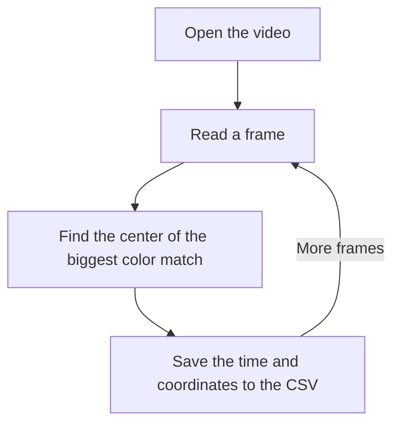

# Centroid Finder Video Part II Plan

## Goal

The goal is to find out the location of the largest group of pixels matching a designated color in an MP4 video. A path to the video file, destination location of the CSV file, target color, and tolerance in pixel colors have to be provided by the user. In a CSV file, timestamps and center coordinates of the matching group will be logged, in case there are no matches “-1,-1” will be recorded in the files.

## Components

- Video reader
- Argument parser
- Centroid processor
- CSV writer
- Main application

## Architecture

## Division of Labor

We have a lot of this working already.

I can handle the command line and CSV writing. If you want to handle the frames and integrating them into our existing centroid finder, I think we will be good.

## Testing

I ran the JAR on the salamander video with FFA200 as the target color and 164 as the threshold. It saved 633 rows to the CSV. I checked a few rows from the beginning, middle, and near the end, and the coordinates stayed close together. At about 13 seconds, the program gave me (416, 364). I still need to check whether that point is on the salamander.
