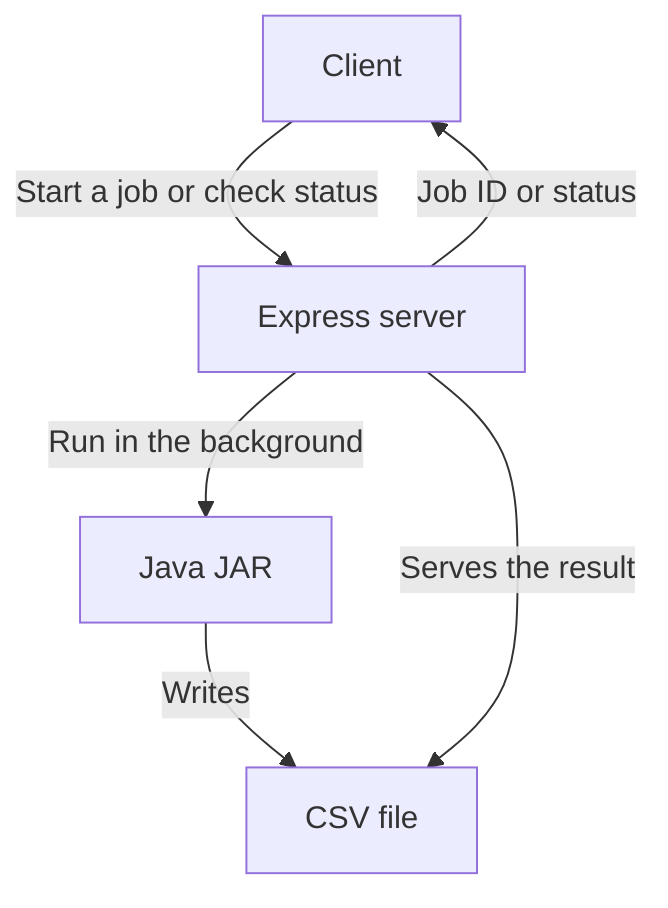

# Salamander Server Plan

- Express lists local videos and shows the first frame as a thumbnail.
- Express runs our Java JAR in the background and returns a job ID right away.
- The JAR writes the CSV. The client checks the job status to get the CSV link.

## How the parts work together

## How I’d test it

- In Postman, start a job for `sample.mp4` and 
check that it returns `202` with a job ID. Use that ID to check the status,
 then open the CSV link when the job is done.
